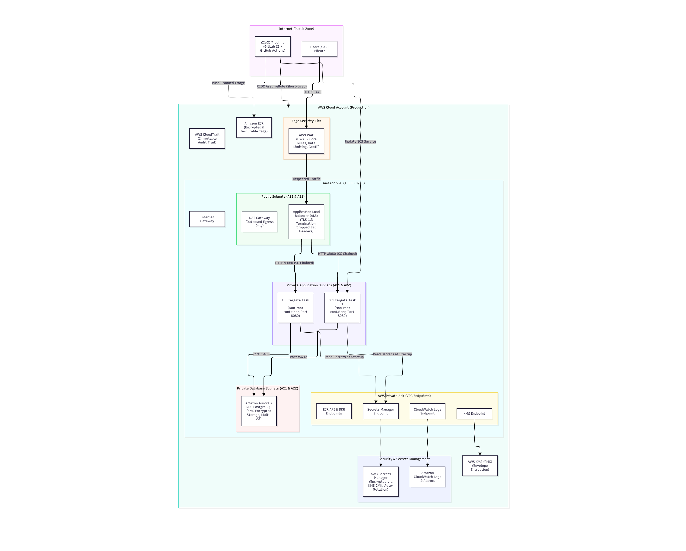
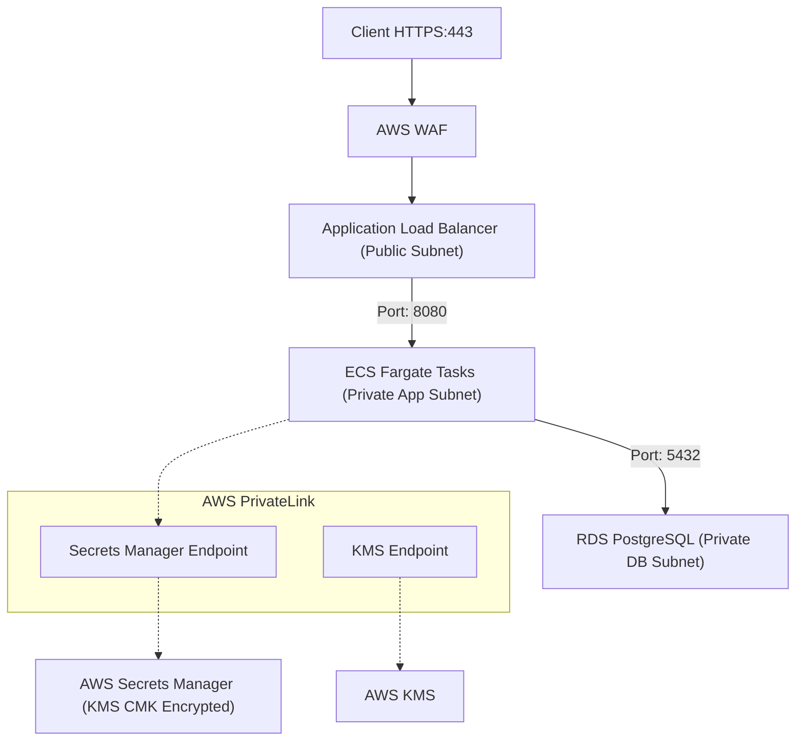
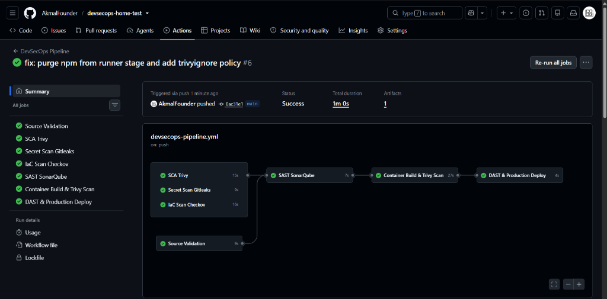

# DevSecOps Take-Home Test: Containerized API & Automated Pipeline

This repository contains an end-to-end implementation of the DevSecOps Engineer Take-Home Test. It features a hardened Node.js backend container, an AWS reference architecture using ECS Fargate, and a complete 8-stage CI/CD security pipeline enforcing automated security gates with SonarQube, Trivy, Gitleaks, Checkov, and OWASP ZAP.

---

## Table of Contents
1. [Architecture Overview](#1-architecture-overview)
2. [Project Structure](#2-project-structure)
3. [Prerequisites & Quick Start](#3-prerequisites--quick-start)
4. [CI/CD Pipeline & Security Gates](#4-cicd-pipeline--security-gates)
5. [Security Decisions & Assumptions](#5-security-decisions--assumptions)
6. [Commands to Validate & Scan](#6-commands-to-validate--scan)
7. [Incident Response & Scenarios](#7-incident-response--scenarios)
8. [Known Limitations & Remaining Risks](#8-known-limitations--remaining-risks)
9. [Evidence & Security Reports](#9-evidence--security-reports)
10. [Pipeline Execution Results](#10-pipeline-execution-results)

---

## 1. Architecture Overview

The backend API runs on **AWS ECS Fargate** across two availability zones inside a custom VPC. Traffic from the internet is inspected by **AWS WAF** before reaching the **Application Load Balancer (ALB)** in the public subnets. The application containers and database instances reside strictly in private subnets with zero direct internet access.





Key architectural highlights:
- **Network Isolation**: Three-tier subnet topology (Public ALB tier, Private compute tier, Private database tier).
- **Zero Hardcoded Secrets**: Secrets are provisioned in AWS Secrets Manager and decrypted into container memory at task boot time via the Task Execution Role.
- **KMS Envelope Encryption**: All database storage, secrets, and CloudWatch logs are encrypted with a Customer Managed Key (CMK) configured for annual rotation.

For full architectural details, consult [`architecture/architecture-design.md`](architecture/architecture-design.md).

---

## 2. Project Structure

```text
devsecops-home-test/
├── README.md                          # Project documentation
├── sonar-project.properties           # SonarQube scanner configuration
├── architecture/
│   ├── architecture-design.md         # Task 1 comprehensive design answers
│   ├── architecture-diagram.svg       # Vector architecture diagram
│   ├── architecture-diagram.png       # Rendered PNG diagram
│   └── architecture-diagram.mermaid   # Mermaid diagram source
├── app/
│   ├── Dockerfile                     # Multi-stage non-root container definition
│   ├── .dockerignore                  # Build context exclusions
│   ├── package.json                   # Application dependencies
│   ├── package-lock.json              # Pinned dependencies for SCA
│   └── src/
│       └── app.js                     # Express API with health checks and helmet
├── terraform/
│   ├── main.tf                        # VPC, ECS, ALB, KMS, Secrets Manager
│   ├── variables.tf                   # Variable declarations
│   ├── outputs.tf                     # Resource outputs
│   ├── terraform.tfvars.example       # Example variables template
│   └── scenarios/
│       ├── scenario-a-iam-fix.tf      # Scoped OIDC deployment role
│       ├── scenario-b-rds-fix.tf      # Private subnet RDS configuration
│       └── scenario-c-secret-fix.md   # Secret leak containment and remediation
├── .gitlab-ci.yml                     # 8-Stage GitLab CI/CD pipeline (SonarQube)
├── .github/
│   └── workflows/
│       └── devsecops-pipeline.yml     # Equivalent GitHub Actions workflow
├── security/
│   ├── vulnerability-policy.md        # Severity SLAs and unpatched CVE protocol
│   └── incident-response.md           # Task 5 runbooks & Task 6 DAST details
└── evidence/
    ├── scan-results.md                # Raw text scan outputs
    └── security-report.html           # Interactive HTML security dashboard
```

---

## 3. Prerequisites & Quick Start

### Prerequisites
- Node.js 20+
- Docker Engine 24+
- Git 2.30+

---

## 4. CI/CD Pipeline & Security Gates

The pipeline enforces eight consecutive stages on every commit and merge request:

| Stage | Control | Tool | Gate Condition |
| :---: | :--- | :--- | :--- |
| **1** | Source Validation | `node --check` | Fails on syntax error |
| **2** | SAST | **SonarQube** | Fails if Quality Gate is not met |
| **3** | SCA | **Trivy FS** | Fails on High or Critical CVE |
| **4** | Secret Scanning | **Gitleaks** | Fails if any token or key is found |
| **5** | IaC Scanning | **Checkov** | Fails on security misconfigurations |
| **6** | Container Build | **Docker Buildx** | Fails if build fails |
| **7** | Container Scan | **Trivy Image** | Fails on High or Critical CVE |
| **8** | DAST & Deploy | **OWASP ZAP** | Fails on High/Critical findings; requires manual approval for prod |

---

## 5. Security Decisions & Assumptions

1. **SonarQube Quality Profile**: We configure standard Sonar way rules enforcing static security checks, bug detection, and code smell tracking.
2. **OIDC Instead of Static AWS Credentials**: The pipeline never stores `AWS_ACCESS_KEY_ID` or `AWS_SECRET_ACCESS_KEY`. Instead, GitLab/GitHub exchanges a short-lived OIDC token with AWS STS for temporary credentials.
3. **Non-Root Container**: The container runs under the dedicated `node` user (UID 1000) and listens on port 8080, preventing potential privilege escalation from container to host.
4. **Separation of IAM Roles**:
   - `Task Execution Role`: Used by AWS infrastructure agent to pull images and fetch Secrets Manager secrets.
   - `Task Role`: Used by the application code at runtime.
   - `CI/CD Deployer Role`: Used by the pipeline to update ECS services and push to ECR.

---

## 6. Commands to Validate & Scan

You can validate and execute the security scans using Docker:

```bash
# 1. Source Syntax Validation (Local)
node --check app/src/app.js

# 2. Secret Scanning (Gitleaks)
docker run --rm -v "${PWD}:/path" zricethezav/gitleaks:latest detect --source="/path" -v

# 3. SCA Dependency Scan (Trivy FS)
docker run --rm -v "${PWD}/app:/root" aquasec/trivy:latest fs --severity HIGH,CRITICAL /root

# 4. Infrastructure as Code Scanning (Checkov)
docker run --rm -v "${PWD}/terraform:/tf" bridgecrew/checkov:latest \
  -d /tf --config-file /tf/terraform/.checkov.yaml

# 5. Container Image Vulnerability Scan (Trivy Image)
docker run --rm -v /var/run/docker.sock:/var/run/docker.sock aquasec/trivy:latest image \
  --severity HIGH,CRITICAL --exit-code 1 devsecops-backend-api:latest

# 6. DAST Runtime Scan (OWASP ZAP)
docker run --rm --network="host" -t zaproxy/zap-stable:latest zap-baseline.py \
  -t http://127.0.0.1:8080 -r zap-report.html -I

# Note on SAST (SonarQube):
# Executed automatically in the CI/CD pipeline via GitHub Actions using sonar-project.properties.
```

---

## 7. Incident Response & Scenarios

The repository includes detailed remediation notes for the home test scenarios:
- **Scenario A (Overly Permissive IAM)**: Proposes a scoped, short-lived OIDC role in [`terraform/scenarios/scenario-a-iam-fix.tf`](terraform/scenarios/scenario-a-iam-fix.tf).
- **Scenario B (Publicly Accessible RDS)**: Demonstrates private subnet placement and strict SG chaining in [`terraform/scenarios/scenario-b-rds-fix.tf`](terraform/scenarios/scenario-b-rds-fix.tf).
- **Scenario C (Secret Exposure in State)**: Documents step-by-step password rotation, git history purging, and decoupling secrets into Secrets Manager in [`terraform/scenarios/scenario-c-secret-fix.md`](terraform/scenarios/scenario-c-secret-fix.md).
- **Troubleshooting Runbooks**: Comprehensive incident response procedures for base image vulnerabilities, ECS startup failures, and unauthorized CloudTrail activity are located in [`security/incident-response.md`](security/incident-response.md).

---

## 8. Known Limitations & Remaining Risks

1. **Zero-Day Vulnerability Window**: Scanners rely on published CVE databases. Zero-day flaws unknown to the community require runtime defense (AWS WAF and GuardDuty anomaly detection).
2. **Authentication in DAST**: Automated baseline scans test unauthenticated paths; complex business flows require authenticated OpenAPI fuzzing with ephemeral test accounts.
3. **Manual Drift**: Changes made directly through the AWS Console bypass Terraform and IaC scanning. Mitigated by continuous drift-detection pipelines and strict SCPs.

---

## 9. Evidence & Security Reports

Two comprehensive reports are available:
1. **Interactive HTML Dashboard**: Open [`evidence/security-report.html`](evidence/security-report.html) in any browser for an executive dashboard with status cards and tables.
2. **Raw Log File & Visual Evidence**: Inspect [`evidence/scan-results.md`](evidence/scan-results.md) for terminal output logs, before-and-after remediation comparisons, and visual scan evidence from all security controls.

---

## 10. Pipeline Execution Results

All automated security controls and deployment gates executed successfully with zero blockers on GitHub Actions:



