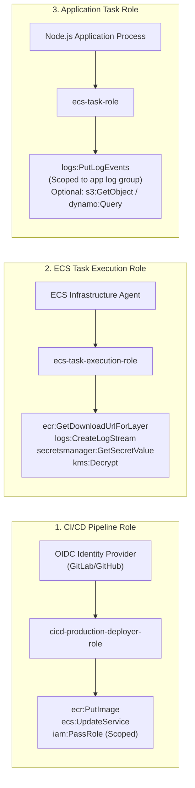

# Task 1: AWS Architecture and Security Design

## 1. Architecture Overview
This document specifies the secure, resilient AWS cloud architecture for deploying a containerized backend REST API. The design adheres strictly to the **AWS Well-Architected Framework (Security Pillar)**, adopting defense-in-depth, zero-trust network segregation, immutable logging, and least-privilege identity access management.

---

## 2. Architecture Diagram

```mermaid
flowchart TD
    subgraph Internet_Zone [" Internet (Public Zone) "]
        Client["Users / API Clients"]
        GitLab["CI/CD Pipeline (GitLab CI / GitHub Actions)"]
    end

    subgraph AWS_Cloud [" AWS Cloud Account (Production) "]
        CloudTrail["AWS CloudTrail<br/>(Immutable Audit Trail)"]
        KMS["AWS KMS (CMK)<br/>(Envelope Encryption)"]
        ECR["Amazon ECR<br/>(Encrypted & Immutable Tags)"]

        subgraph Edge_Security [" Edge Security Tier "]
            WAF["AWS WAF<br/>(OWASP Core Rules, Rate Limiting, GeoIP)"]
        end

        subgraph VPC [" Amazon VPC (10.0.0.0/16) "]
            IGW["Internet Gateway"]
            
            subgraph Public_Subnets [" Public Subnets (AZ1 & AZ2) "]
                ALB["Application Load Balancer (ALB)<br/>(TLS 1.3 Termination, Dropped Bad Headers)"]
                NAT["NAT Gateway<br/>(Outbound Egress Only)"]
            end

            subgraph Private_App_Subnets [" Private Application Subnets (AZ1 & AZ2) "]
                ECS1["ECS Fargate Task 1<br/>(Non-root container, Port 8080)"]
                ECS2["ECS Fargate Task 2<br/>(Non-root container, Port 8080)"]
            end

            subgraph Private_Data_Subnets [" Private Database Subnets (AZ1 & AZ2) "]
                RDS["Amazon Aurora / RDS PostgreSQL<br/>(KMS Encrypted Storage, Multi-AZ)"]
            end

            subgraph VPC_Endpoints [" AWS PrivateLink (VPC Endpoints) "]
                VPC_SM["Secrets Manager Endpoint"]
                VPC_KMS["KMS Endpoint"]
                VPC_CW["CloudWatch Logs Endpoint"]
                VPC_ECR["ECR API & DKR Endpoints"]
            end
        end

        subgraph Management_Plane [" Security & Secrets Management "]
            SM["AWS Secrets Manager<br/>(Encrypted via KMS CMK, Auto-Rotation)"]
            CW["Amazon CloudWatch Logs & Alarms"]
        end
    end

    %% Network & Request Flows
    Client -->|HTTPS :443| WAF
    WAF -->|Inspected Traffic| ALB
    ALB -->|HTTP :8080 (SG Chained)| ECS1
    ALB -->|HTTP :8080 (SG Chained)| ECS2
    ECS1 -->|Port :5432| RDS
    ECS2 -->|Port :5432| RDS

    %% Private AWS API Communications
    ECS1 -.->|Read Secrets at Startup| VPC_SM
    ECS2 -.->|Read Secrets at Startup| VPC_SM
    VPC_SM -.-> SM
    VPC_KMS -.-> KMS
    VPC_CW -.-> CW

    %% CI/CD Deployment Flow
    GitLab -.->|OIDC AssumeRole (Short-lived)| AWS_Cloud
    GitLab -.->|Push Scanned Image| ECR
    GitLab -.->|Update ECS Service| ECS1

    %% Styling
    classDef public fill:#ffebee,stroke:#c62828,stroke-width:2px;
    classDef private fill:#e8f5e9,stroke:#2e7d32,stroke-width:2px;
    classDef security fill:#e3f2fd,stroke:#1565c0,stroke-width:2px;
    class Client,GitLab public;
    class WAF,KMS,SM,CloudTrail security;
    class ECS1,ECS2,RDS private;
```

---

## 3. Core Requirements & Detailed Technical Responses

### Requirement 1: Request Flow from the Internet to the Application
1. **DNS & Edge Protection**:
   - The client performs a DNS lookup via Route 53 and initiates an HTTPS (port 443) request.
   - Traffic hits **AWS WAF (Web Application Firewall)** deployed directly at the Application Load Balancer.
   - WAF inspects incoming requests against OWASP Top 10 rulesets, IP reputation lists, SQL Injection (SQLi) patterns, Cross-Site Scripting (XSS), and automated rate-limiting thresholds (e.g., maximum 500 requests per 5 minutes per IP).
2. **TLS Termination & Load Balancing**:
   - Requests passing WAF are received by the **Application Load Balancer (ALB)** in the Public Subnets.
   - The ALB terminates TLS using a modern security policy (e.g., `ELBSecurityPolicy-TLS13-1-2-2021-06`). All plain HTTP (port 80) traffic is automatically redirected with HTTP 301 to HTTPS (port 443).
   - ALB drops malformed or invalid HTTP headers (`drop_invalid_header_fields = true`) to mitigate HTTP request smuggling attacks.
3. **Internal Routing to Compute**:
   - The ALB evaluates routing rules and forwards the traffic across target groups over private IP addresses to **Amazon ECS Fargate** tasks running in the **Private Application Subnets** on port 8080.
4. **Data Access**:
   - If the request requires database persistence, the backend container queries Amazon RDS inside the **Private Database Subnets** on port 5432. All database connections enforce TLS in transit.

---

### Requirement 2: Public vs. Private Resource Segregation

| Resource | Placement | Ingress Rule | Egress Rule | Justification |
| :--- | :--- | :--- | :--- | :--- |
| **Application Load Balancer (ALB)** | **Public Subnets** | Ingress `0.0.0.0/0` on port 443 (HTTPS) and port 80 (HTTP redirect). | Egress restricted strictly to `sg-ecs-tasks` on port 8080. | The only component exposed to the internet. Acts as a protective reverse proxy. |
| **NAT Gateway** | **Public Subnets** | Ingress from private subnets (VPC internal CIDR). | Egress `0.0.0.0/0` on port 443. | Provides outbound internet access for private workloads (e.g., OS updates) without allowing inbound traffic. |
| **Amazon ECS Fargate Tasks** | **Private Subnets** (App Tier) | Ingress strictly from `sg-alb` on port 8080. Zero public access. | Egress to VPC Endpoints / NAT Gateway for AWS APIs. | `assign_public_ip = false`. Protected from direct internet probing, port scans, and DDoS. |
| **Amazon RDS Database** | **Private Subnets** (Data Tier) | Ingress strictly from `sg-ecs-tasks` on port 5432. | No outbound internet access allowed. | Complete air-gapping from public networks prevents database exploitation and unauthorized external access. |
| **Secrets Manager & KMS** | **AWS Managed Plane** | Accessible only via IAM authentication over AWS PrivateLink VPC Endpoints. | N/A | Secrets and encryption keys are never exposed to public routing tables. |

---

### Requirement 3: How the Application Retrieves Secrets Without Hardcoding
To satisfy zero-secret hardcoding in Git, Docker images, and environment variables:
1. **Secret Storage**:
   - Database credentials, API tokens, and JWT signing keys are stored inside **AWS Secrets Manager** encrypted at rest with an **AWS KMS Customer Managed Key (CMK)**.
2. **Native ECS Task Definition Secret Injection**:
   - Rather than passing credentials through plaintext `environment` blocks, the ECS Task Definition utilizes the native `secrets` syntax:
   ```json
   "secrets": [
     {
       "name": "DB_PASSWORD",
       "valueFrom": "arn:aws:secretsmanager:ap-southeast-1:123456789012:secret:devsecops/prod/db-credentials:password::"
     }
   ]
   ```
3. **Execution Sequence**:
   - During container provisioning, the **AWS ECS Container Agent** (using the *Task Execution Role*) calls `secretsmanager:GetSecretValue` and `kms:Decrypt`.
   - The agent securely injects the secret directly into the container's in-memory process environment as `DB_PASSWORD`.
   - The secret is never written to disk, never baked into Docker layers, and never committed to Git.
4. **Automated Secret Rotation**:
   - AWS Secrets Manager runs an automated Lambda rotation function every 30 days. When credentials rotate, ECS tasks gracefully reload without downtime.

---

### Requirement 4: IAM Roles Required by CI/CD Pipeline and Runtime Application
We strictly isolate identity and enforce the Principle of Least Privilege (PoLP):



1. **CI/CD Deployment Role (`cicd-production-deployer-role`)**:
   - Assumed dynamically via **AWS IAM OpenID Connect (OIDC)** without static `AWS_ACCESS_KEY_ID`.
   - Permissions: Scoped strictly to push Docker images to the specific ECR repository, register new ECS task definition revisions, update the ECS service, and `iam:PassRole` restricted only to the two task roles.
2. **ECS Task Execution Role (`ecs-task-execution-role`)**:
   - Assumed by the **AWS ECS infrastructure control plane agent**.
   - Permissions: Pull container images from Amazon ECR, stream initialization logs to CloudWatch, retrieve secret values from Secrets Manager, and call `kms:Decrypt` on the CMK.
3. **ECS Application Task Role (`ecs-task-role`)**:
   - Assumed by the **running code inside the container**.
   - Permissions: Zero infrastructure administrative rights. Restricted only to what the application code specifically executes at runtime (e.g., publishing metrics to CloudWatch, reading from a designated S3 bucket). Even if the application suffered a Remote Code Execution (RCE) exploit, the attacker cannot modify AWS infrastructure or access unrelated secrets.

---

### Requirement 5: Preventing Unauthorized Access to Production Resources
1. **Short-Lived OIDC Authentication**:
   - Eliminate all permanent IAM user access keys. The CI/CD pipeline obtains temporary, 15-minute AWS STS session credentials validated against the cryptographic OIDC JWT token matching `repo:myorg/myrepo:ref:refs/heads/main`.
2. **Multi-Account Segregation & AWS Organizations**:
   - Production workloads reside in a dedicated AWS Production Account separated from Development and Staging accounts.
   - Service Control Policies (SCPs) prevent disabling CloudTrail, leaving GuardDuty, or creating public S3 buckets.
3. **Privileged Access Management (PAM) & Break-Glass**:
   - Zero permanent admin console access for developers.
   - Engineers use AWS IAM Identity Center (SSO) with Mandatory Multi-Factor Authentication (FIDO2 / Hardware Security Keys). Production access requires a peer-approved temporary session via PagerDuty/Jira break-glass workflow.
4. **AWS GuardDuty & Security Hub**:
   - Continuous AI/ML threat detection analyzing VPC Flow Logs, DNS logs, and CloudTrail management events to alert on anomalous API calls, port scans, or compromised instances.

---

### Requirement 6: Five Key Security Risks and Mitigations

| # | Identified Security Risk | Threat Vector | Comprehensive Mitigation Strategy |
| :---: | :--- | :--- | :--- |
| **1** | **Direct Database & Compute Exposure** | Misconfigured security group or public subnet route allows internet attackers to probe DB port 5432 or container port 8080. | Place ECS tasks and databases in private subnets with no internet gateway route. Enforce chained security groups where DB accepts traffic *only* from the ECS SG, and ECS accepts traffic *only* from ALB SG. Detect via Checkov `CKV_AWS_17`. |
| **2** | **Credential Leakage in Git / CI/CD** | Developer accidentally commits `.env`, AWS access keys, or database passwords to source code. | Replace static AWS keys with **OIDC token federation**. Implement **Gitleaks** as a pre-commit hook and hard CI/CD gate that immediately halts any commit containing high-entropy keys or passwords. |
| **3** | **Container Escape & Privilege Escalation** | Vulnerability in the Linux kernel or application allows attacker to break out of container to host system. | Run containers using **AWS Fargate** (microVM isolation per task). Run application process as **non-root user** (`USER node`), mount root filesystem as read-only (`readonlyRootFilesystem: true`), and drop all Linux capabilities (`cap_drop: ["ALL"]`). |
| **4** | **Supply Chain Vulnerability (Vulnerable Dependencies)** | Open-source npm package contains known CVE (e.g., prototype pollution or malicious backdoor). | Enforce strict lockfiles (`package-lock.json`). Integrate automated **Software Composition Analysis (SCA)** using Trivy and `npm audit` in the CI/CD pipeline to block builds containing vulnerabilities above high/critical threshold. |
| **5** | **Layer 7 DDoS & Web Application Exploits** | Attacker launches SQL Injection, Cross-Site Scripting, or HTTP flood targeting the backend API. | Deploy **AWS WAF** in front of the Application Load Balancer with AWS Managed Rules (Core Rule Set, Known Bad Inputs, Amazon IP Reputation list) and a rate-based rule limiting requests to 500 req/5 min per IP. |

---

## 4. Example Critical Security Control: Scoped KMS Key Policy
Below is the production-grade Key Policy for the AWS KMS Customer Managed Key (CMK) ensuring envelope encryption at rest while preventing unauthorized decryption:

```json
{
  "Version": "2012-10-17",
  "Id": "DevSecOpsKmsKeyPolicy",
  "Statement": [
    {
      "Sid": "EnableIAMUserPermissions",
      "Effect": "Allow",
      "Principal": {
        "AWS": "arn:aws:iam::123456789012:root"
      },
      "Action": "kms:*",
      "Resource": "*"
    },
    {
      "Sid": "AllowECSExecutionRoleToDecryptSecret",
      "Effect": "Allow",
      "Principal": {
        "AWS": "arn:aws:iam::123456789012:role/devsecops-backend-production-task-execution-role"
      },
      "Action": [
        "kms:Decrypt",
        "kms:DescribeKey"
      ],
      "Resource": "*",
      "Condition": {
        "StringEquals": {
          "kms:ViaService": "secretsmanager.ap-southeast-1.amazonaws.com"
        }
      }
    },
    {
      "Sid": "AllowCloudWatchLogsEncryption",
      "Effect": "Allow",
      "Principal": {
        "Service": "logs.ap-southeast-1.amazonaws.com"
      },
      "Action": [
        "kms:Encrypt*",
        "kms:Decrypt*",
        "kms:ReEncrypt*",
        "kms:GenerateDataKey*",
        "kms:Describe*"
      ],
      "Resource": "*"
    }
  ]
}
```
