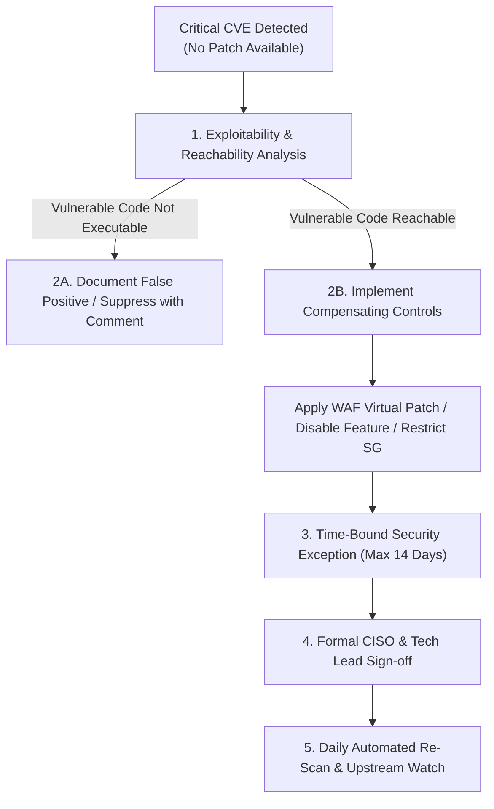

# DevSecOps Vulnerability Management & Remediation Policy

## 1. Purpose & Scope
This policy defines the governance, triage protocols, remediation timelines (SLAs), and security gate thresholds for vulnerabilities identified across the Software Development Life Cycle (SDLC). It applies to all application source code (SAST), open-source software libraries (SCA), container base images, infrastructure-as-code (IaC), and runtime dynamic endpoints (DAST).

---

## 2. Severity Classification & Pipeline Gate Enforcement

The CI/CD pipeline enforces automated security gates based on Common Vulnerability Scoring System (CVSS v3.1) metrics and environmental exploitability:

| Severity | CVSS v3 Score | Pipeline Gate Action | SLA for Remediation | Assigned Owner |
| :---: | :---: | :--- | :---: | :--- |
| **CRITICAL** | **9.0 – 10.0** | **BLOCK BUILD / RELEASE (Exit 1)**<br/>No deployment to staging or production allowed without approved exception. | **24 - 48 Hours** | Lead Security Engineer & Core Dev Team |
| **HIGH** | **7.0 – 8.9** | **BLOCK RELEASE (Exit 1)** for internet-exposed or reachable components.<br/>Conditional allow for purely internal batch workloads with approval. | **7 Calendar Days** | Application Feature Team |
| **MEDIUM** | **4.0 – 6.9** | **WARN & LOG**<br/>Recorded in vulnerability tracking backlog (Jira/GitLab Issues). Pipeline continues. | **30 Calendar Days** | Application Team Sprint Backlog |
| **LOW** | **0.1 – 3.9** | **INFO ONLY**<br/>Reviewed during scheduled maintenance cycles. | **90 Calendar Days** | Application Team Maintenance |

---

## 3. Policy for Unpatched Critical Vulnerabilities (No Upstream Fix Available)

A critical vulnerability with **no patched version available** (Zero-Day or delayed upstream maintainer release) presents a high-risk operational dilemma: releasing may expose the system, but completely blocking may disrupt critical business operations.

When this occurs, the following **5-Step Defense-in-Depth Protocol** must be executed:



### Step 1: Exploitability & Reachability Analysis
Determine if the vulnerable code path is actually reachable by untrusted input:
- Is the affected function called in the application flow?
- Does exploitation require root/local privileges that our non-root container prevents?
- Is the component exposed to the public internet, or isolated in the private subnet?

### Step 2: Implementation of Compensating Controls (Virtual Patching)
If the component cannot be removed or updated, compensating security controls must be activated:
1. **AWS WAF Virtual Patching**: Inject custom regex / rate-limit rules at the Application Load Balancer to inspect and drop malicious payloads matching the CVE signature (e.g., Log4Shell JNDI strings).
2. **Feature Flag Disabling**: Temporarily disable the vulnerable sub-feature in the application configuration.
3. **Network Egress Restriction**: Restrict container egress via Security Groups or DNS firewalls to prevent outbound reverse shell connections or command-and-control (C2) callbacks.
4. **Alternative Minimal Base Image**: Migrate from standard distribution base images to ultra-minimal distroless images (e.g., Google Distroless or Chainguard), stripping unused OS packages (like curl, bash, openssl) that host the vulnerability.

### Step 3: Formal Security Exception Request & Sign-off
If business-critical deployment is required before an upstream patch is published:
- An official **Security Exception Request** must be filed containing:
  - CVE identifier and CVSS score.
  - Business justification for immediate deployment.
  - Verification of active compensating controls.
  - Rollback plan.
- **Mandatory Approval**: Requires dual written sign-off by the **Head of Security / CISO** and the **Engineering Director**.
- **Time-Bound Validity**: Exceptions expire automatically after **14 days**, after which the pipeline gate re-engages.

### Step 4: Continuous Upstream Monitoring
- Subscribe to the CVE alert feed via Trivy / Snyk / NVD.
- The pipeline re-evaluates the exception daily; as soon as a patch is released, the exception is invalidated, and the team must deploy the patch within 24 hours.

---

## 4. Handling False Positives and Accepted Risks

### A. False Positive Triage
A finding is classified as a false positive if:
1. The scanner flags a test fixture, mock file, or dev-only dependency not bundled in production.
2. The detected code pattern is safe due to sanitization frameworks (e.g., parameterized ORM queries flagged as SQL injection).

**Suppression Governance**:
- Suppressions must **never** be placed globally (`--skip-all`).
- Suppressions must be recorded in the repository's configuration file (e.g., `.trivyignore`, `.checkov.yaml`, or `.gitleaksignore`) with:
  1. The exact CVE / Rule ID.
  2. Technical justification explaining why it is non-exploitable.
  3. Expiration date (maximum 6 months).
  4. Approver name.

Example `.trivyignore`:
```text
# CVE-2024-XXXXX: Affects optional CLI tool not invoked in production API
# Compensating Control: Non-root user, no interactive shell
# Approver: SecOps Lead
# Expire-Date: 2026-12-31
CVE-2024-XXXXX
```

### B. Accepted Risks
Accepted risks are managed through an enterprise Risk Register. Any risk acceptance requires quarterly re-certification and must be reviewed whenever architectural changes occur.
